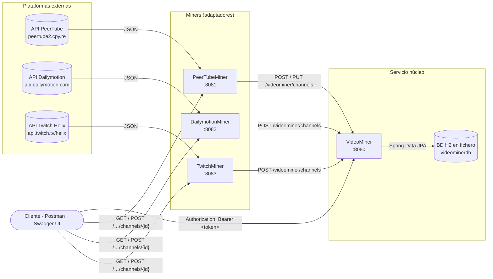
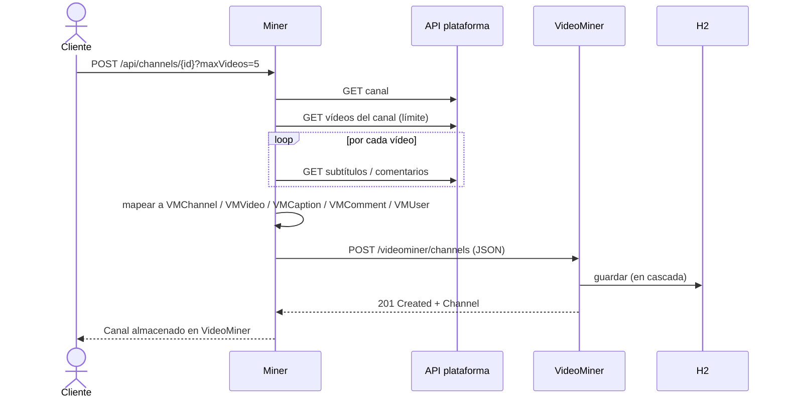
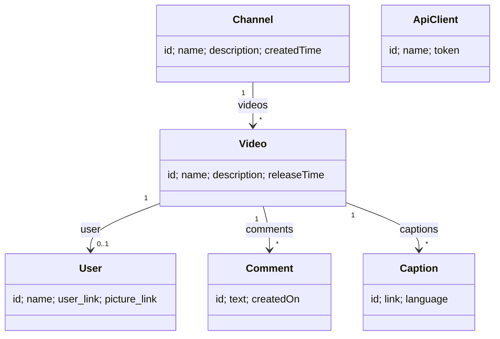

# VideoMiner — Microservicios de minería de datos de vídeo

> 🇬🇧 [Read in English](README.md)

[](https://openjdk.org/projects/jdk/21/)
[](https://spring.io/projects/spring-boot)
[](https://maven.apache.org/)
[](https://microservices.io/)
[](https://www.informatica.us.es/)

Conjunto de **cuatro microservicios Spring Boot** que extraen (*minan*) datos de canales y vídeos de tres plataformas públicas — **PeerTube**, **Dailymotion** y **Twitch** —, los traducen a un modelo de datos común y los almacenan en una API REST central llamada **VideoMiner**.

Proyecto de grupo de la asignatura **Arquitectura e Integración de Sistemas Software (AISS)** — Grado en Ingeniería Informática – Ingeniería del Software, ETSII, Universidad de Sevilla.

---

## Índice

- [VideoMiner — Microservicios de minería de datos de vídeo](#videominer--microservicios-de-minería-de-datos-de-vídeo)
  - [Índice](#índice)
  - [Qué hace el sistema](#qué-hace-el-sistema)
  - [Arquitectura](#arquitectura)
  - [Estructura del repositorio](#estructura-del-repositorio)
  - [Tecnologías](#tecnologías)
  - [Puesta en marcha](#puesta-en-marcha)
    - [Requisitos](#requisitos)
    - [1. Clonar](#1-clonar)
    - [2. Arrancar primero VideoMiner (puerto 8080)](#2-arrancar-primero-videominer-puerto-8080)
    - [3. Arrancar los miners (una terminal por cada uno)](#3-arrancar-los-miners-una-terminal-por-cada-uno)
  - [Ejemplo completo](#ejemplo-completo)
  - [API de VideoMiner (núcleo)](#api-de-videominer-núcleo)
  - [API de los miners (adaptadores)](#api-de-los-miners-adaptadores)
  - [Modelo de datos común](#modelo-de-datos-común)
  - [Cómo se mapea cada plataforma](#cómo-se-mapea-cada-plataforma)
  - [Seguridad](#seguridad)
  - [Configuración](#configuración)
  - [Pruebas](#pruebas)
  - [Decisiones de diseño](#decisiones-de-diseño)

---

## Qué hace el sistema

Cada plataforma de vídeo tiene su propia API con su propio vocabulario: PeerTube habla de *video-channels* y *comment-threads*, Dailymotion de *subtitles* y *owners*, Twitch de *broadcasters*, *streams* y *clips*. El objetivo del proyecto es **integrar estas fuentes heterogéneas** detrás de una única API uniforme.

1. Un **miner** recibe una petición del tipo "mina el canal `X`".
2. Llama a la API de la plataforma externa y recoge el canal, sus vídeos y sus subtítulos/comentarios.
3. **Mapea** todo al modelo común de VideoMiner (`Channel → Video → Caption / Comment / User`).
4. **Envía** el resultado a VideoMiner con `POST /videominer/channels`.
5. VideoMiner lo **persiste** (JPA + H2) y lo expone mediante una API REST paginada, filtrable y protegida con token.

## Arquitectura

Los miners siguen el **patrón Adaptador**: cada uno traduce una API concreta al mismo contrato, de modo que VideoMiner nunca necesita saber de dónde vienen los datos.



**Secuencia de ingesta** (igual en todos los miners):



## Estructura del repositorio

```
.
├── VideoMiner/          # API REST central: persistencia, consultas, seguridad por API key, Swagger
├── PeerTubeMiner/       # Adaptador para PeerTube
├── DailymotionMiner/    # Adaptador para Dailymotion
├── TwitchMiner/         # Adaptador para Twitch (Helix)
├── README.md            # Versión en inglés
└── README.es.md         # Este fichero (español)
```

Cada carpeta es un **proyecto Maven independiente** con su propio `pom.xml` y Maven Wrapper (`mvnw` / `mvnw.cmd`), así que cada servicio se compila, ejecuta y despliega por separado.

| Servicio         | Puerto | Ruta base         | Spring Boot | Paquete principal                 |
| ---------------- | ------ | ----------------- | ----------- | --------------------------------- |
| VideoMiner       | `8080` | `/videominer`     | 3.2.1       | `aiss.videominer`                 |
| PeerTubeMiner    | `8081` | `/api/channels`   | 3.5.15      | `peertubeminer.peertube`          |
| DailymotionMiner | `8082` | `/api/channels`   | 3.5.15      | `com.example.dailymotionminer`    |
| TwitchMiner      | `8083` | `/helix/channels` | 4.0.6       | `com.aisstwitchminer.twitchminer` |

## Tecnologías

- **Java 21** y **Spring Boot** (Spring Web, Spring Data JPA, Bean Validation)
- Base de datos **H2** en modo fichero para VideoMiner (`./videominerdb`)
- **springdoc-openapi** — documentación Swagger UI / OpenAPI 3 de VideoMiner
- **RestTemplate** para las llamadas HTTP entre servicios y a las APIs externas
- **Maven** (con wrapper) y pruebas con **JUnit 5**
- Patrones: microservicios, Adaptador, DTOs por servicio (`model/<plataforma>` frente a `model/videominer`), `HandlerInterceptor` propio para las API keys

## Puesta en marcha

### Requisitos

- **JDK 21** (`java -version` debe mostrar 21 o superior)
- No hace falta instalar Maven: cada servicio incluye el Maven Wrapper
- Conexión a internet (los miners llaman a APIs públicas)
- Solo para Twitch: un **Client ID** de una app de Twitch y un **token OAuth de aplicación** ([documentación de Twitch](https://dev.twitch.tv/docs/authentication/))

### 1. Clonar

```bash
git clone https://github.com/<tu-usuario>/<este-repo>.git
cd <este-repo>
```

### 2. Arrancar primero VideoMiner (puerto 8080)

Los miners necesitan VideoMiner en marcha para guardar los datos.

```bash
cd VideoMiner
./mvnw spring-boot:run          # Windows: mvnw.cmd spring-boot:run
```

Comprueba que funciona abriendo <http://localhost:8080/swagger-ui.html>.

### 3. Arrancar los miners (una terminal por cada uno)

```bash
cd PeerTubeMiner    && ./mvnw spring-boot:run   # http://localhost:8081
cd DailymotionMiner && ./mvnw spring-boot:run   # http://localhost:8082
```

TwitchMiner lee sus credenciales de variables de entorno:

```bash
# Linux / macOS
export TWITCH_CLIENT_ID=tu_client_id
export TWITCH_OAUTH_TOKEN=tu_token
cd TwitchMiner && ./mvnw spring-boot:run        # http://localhost:8083
```

```powershell
# Windows PowerShell
$env:TWITCH_CLIENT_ID="tu_client_id"
$env:TWITCH_OAUTH_TOKEN="tu_token"
cd TwitchMiner; .\mvnw.cmd spring-boot:run
```

> ⚠️ No subas nunca credenciales reales de Twitch al repositorio. Se leen del entorno precisamente para eso.

## Ejemplo completo

```bash
# 1) Previsualizar lo que enviaría PeerTube (no se guarda nada)
curl "http://localhost:8081/api/channels/<handle-del-canal>?maxVideos=3&maxComments=2"

# 2) Minarlo y guardarlo en VideoMiner
curl -X POST "http://localhost:8081/api/channels/<handle-del-canal>?maxVideos=3&maxComments=2"

# 3) Obtener un token de VideoMiner
curl -X POST http://localhost:8080/videominer/register/mi-cliente
# -> {"id":1,"name":"mi-cliente","token":"3f1c...-...."}

# 4) Consultar los datos guardados con el token
TOKEN=3f1c...
curl -H "Authorization: Bearer $TOKEN" "http://localhost:8080/videominer/channels?page=0&size=5"
curl -H "Authorization: Bearer $TOKEN" "http://localhost:8080/videominer/videos?name=tutorial&order=-releaseTime"
```

Dailymotion funciona igual en el puerto `8082`. Sus canales son categorías (`news`, `music`, `sport`…), p. ej. `POST localhost:8082/api/channels/news?maxVideos=3&maxPages=1`. Twitch usa el id numérico del broadcaster: `POST localhost:8083/helix/channels/{broadcasterId}`.

## API de VideoMiner (núcleo)

URL base: `http://localhost:8080` · Documentación interactiva: `/swagger-ui.html` · Especificación OpenAPI: `/v3/api-docs`

| Método         | Endpoint                             | Descripción                                                                                  | Auth    |
| -------------- | ------------------------------------ | -------------------------------------------------------------------------------------------- | ------- |
| `POST` / `GET` | `/videominer/register/{serviceName}` | Registra un cliente y devuelve su token (si el nombre ya existe, devuelve el mismo)          | Pública |
| `GET`          | `/videominer/channels`               | Lista canales                                                                                | Bearer  |
| `GET`          | `/videominer/channels/{id}`          | Obtiene un canal                                                                             | Bearer  |
| `POST`         | `/videominer/channels`               | Crea un canal (con vídeos, subtítulos, comentarios y usuarios anidados) — lo usan los miners | Pública |
| `PUT`          | `/videominer/channels/{id}`          | Actualiza un canal                                                                           | Bearer  |
| `DELETE`       | `/videominer/channels/{id}`          | Elimina un canal                                                                             | Bearer  |
| `GET`          | `/videominer/videos`                 | Lista vídeos                                                                                 | Bearer  |
| `GET`          | `/videominer/videos/{id}`            | Obtiene un vídeo                                                                             | Bearer  |
| `GET`          | `/videominer/videos/user/{userId}`   | Vídeos subidos por un usuario                                                                | Bearer  |
| `DELETE`       | `/videominer/videos/{id}`            | Elimina un vídeo                                                                             | Bearer  |
| `GET`          | `/videominer/comments`               | Lista comentarios                                                                            | Bearer  |
| `GET`          | `/videominer/comments/{id}`          | Obtiene un comentario                                                                        | Bearer  |
| `GET`          | `/videominer/captions`               | Lista subtítulos                                                                             | Bearer  |
| `GET`          | `/videominer/captions/{id}`          | Obtiene un subtítulo                                                                         | Bearer  |

**Parámetros de consulta de los listados**

| Parámetro     | Por defecto | Aplica a        | Significado                                                                      |
| ------------- | ----------- | --------------- | -------------------------------------------------------------------------------- |
| `page`        | `0`         | todos           | Número de página (empieza en 0)                                                  |
| `size`        | `10`        | todos           | Tamaño de página                                                                 |
| `order`       | —           | todos           | Campo por el que ordenar; con `-` delante es descendente (p. ej. `-releaseTime`) |
| `name`        | —           | canales, vídeos | Filtra por nombre (contiene)                                                     |
| `description` | —           | canales, vídeos | Filtra por descripción (contiene)                                                |
| `text`        | —           | comentarios     | Filtra por texto (contiene)                                                      |
| `language`    | —           | subtítulos      | Filtra por idioma (contiene)                                                     |

**Códigos de estado:** `200` OK · `201` Created · `204` No Content (PUT/DELETE) · `400` error de validación (`{"errors": [...]}`) · `401` token ausente o no válido · `404` recurso no encontrado.

## API de los miners (adaptadores)

Los tres miners ofrecen las mismas dos operaciones: **previsualizar** (`GET`, devuelve el canal ya mapeado sin guardarlo) e **ingestar** (`POST`, lo mapea y lo envía a VideoMiner).

| Miner                    | Endpoint                                         | Parámetros (por defecto)            | Extra                                                                                                                    |
| ------------------------ | ------------------------------------------------ | ----------------------------------- | ------------------------------------------------------------------------------------------------------------------------ |
| PeerTubeMiner `:8081`    | `GET` / `POST` `/api/channels/{handle}`          | `maxVideos` (10), `maxComments` (2) | `PUT /api/channels/{handle}` vuelve a minar y actualiza el canal en VideoMiner (obtiene su propio token automáticamente) |
| DailymotionMiner `:8082` | `GET` / `POST` `/api/channels/{canal}`           | `maxVideos` (10), `maxPages` (2)    | `{canal}` es un canal/categoría de Dailymotion, como `news`                                                              |
| TwitchMiner `:8083`      | `GET` / `POST` `/helix/channels/{broadcasterId}` | `maxVideos` (10), `maxComments` (2) | Requiere `TWITCH_CLIENT_ID` y `TWITCH_OAUTH_TOKEN`                                                                       |

Los límites negativos devuelven `400 Bad Request`.

## Modelo de datos común



- Los ids son `String` y las fechas son `String` ISO-8601 (cada plataforma usa un formato/tipo distinto).
- Las relaciones usan `CascadeType.ALL`: al enviar un `Channel` se guarda todo el árbol.
- `name` y `createdTime` (canal) y `name` y `releaseTime` (vídeo) se validan con `@NotEmpty`.
- `ApiClient` es interno de VideoMiner y guarda los tokens de acceso.

Ejemplo de lo que envían los miners:

```json
{
  "id": "123",
  "name": "Mi canal",
  "description": "…",
  "createdTime": "2021-03-01T10:00:00Z",
  "videos": [{
    "id": "abc",
    "name": "Título del vídeo",
    "description": "…",
    "releaseTime": "2023-05-10T18:30:00Z",
    "user": { "id": "u1", "name": "Autor", "user_link": "https://…", "picture_link": "https://…" },
    "captions": [{ "id": "c1", "link": "https://…/es.vtt", "language": "Español" }],
    "comments": [{ "id": "k1", "text": "¡Buen vídeo!", "createdOn": "2023-05-11T09:00:00Z" }]
  }]
}
```

## Cómo se mapea cada plataforma

| VideoMiner | PeerTube                                   | Dailymotion                                                          | Twitch                                                     |
| ---------- | ------------------------------------------ | -------------------------------------------------------------------- | ---------------------------------------------------------- |
| `Channel`  | video-channel (`displayName`, `createdAt`) | channel (`name`, `created_time`)                                     | channel / broadcaster + user (`description`, `created_at`) |
| `Video`    | video (`name`, `publishedAt`)              | video (`title`, `created_time`)                                      | vídeo / VOD (`title`, `description`, `published_at`)       |
| `User`     | account (+ primer avatar)                  | owner (`screenname`, `avatar_720_url`)                               | user (`display_name`, `profile_image_url`)                 |
| `Caption`  | caption (`fileUrl`, etiqueta del idioma)   | subtitle (`url`, `language`)                                         | juego del canal (`box_art_url`, nombre del juego)          |
| `Comment`  | comment-thread (`text`, `createdAt`)       | etiqueta (tag) del vídeo (Dailymotion no tiene comentarios públicos) | clip de ese vídeo (`url`, `created_at`)                    |

Cuando una plataforma no tiene un equivalente exacto, se eligió el concepto más cercano para que el modelo común quede siempre relleno.

## Seguridad

VideoMiner protege sus endpoints con un esquema sencillo de **API key** implementado en `ApiKeyInterceptor`:

1. Un cliente llama a `POST /videominer/register/{nombre}` y recibe un token UUID aleatorio.
2. Cada petición protegida debe incluir `Authorization: Bearer <token>`.
3. Si el token falta o no existe, se responde `401` con `{"error":"Unauthorized", ...}`.

Rutas públicas: `/videominer/register/**`, Swagger (`/swagger-ui/**`, `/v3/api-docs/**`), la consola H2 (`/h2-ui`) y `POST /videominer/channels` (para que los miners puedan ingestar sin token). El `PUT` de PeerTubeMiner se registra como `peertubeminer` y envía su propio token Bearer.

## Configuración

Cada servicio lee `src/main/resources/application.properties`; cualquier valor se puede sobrescribir con una variable de entorno o con `--clave=valor`.

| Servicio         | Propiedad                                          | Valor por defecto                                                               |
| ---------------- | -------------------------------------------------- | ------------------------------------------------------------------------------- |
| VideoMiner       | `spring.datasource.url`                            | `jdbc:h2:file:./videominerdb`                                                   |
| VideoMiner       | `spring.h2.console.path`                           | `/h2-ui` (JDBC URL `jdbc:h2:file:./videominerdb`, usuario `sa`, sin contraseña) |
| PeerTubeMiner    | `peertube.base-url`                                | `https://peertube2.cpy.re`                                                      |
| PeerTubeMiner    | `peertubeminer.maxVideos` / `maxComments`          | `10` / `2`                                                                      |
| DailymotionMiner | `dailymotion.base-url`                             | `https://api.dailymotion.com`                                                   |
| DailymotionMiner | `dailymotion.maxVideos` / `maxPages`               | `10` / `2`                                                                      |
| TwitchMiner      | `twitch.base-url`                                  | `https://api.twitch.tv/helix`                                                   |
| TwitchMiner      | `TWITCH_CLIENT_ID`, `TWITCH_OAUTH_TOKEN`           | *(variables de entorno, vacías por defecto)*                                    |
| Todos los miners | `videominer.base-url` + `videominer.channels-path` | `http://localhost:8080` + `/videominer/channels`                                |

Por ejemplo, para apuntar el miner a otra instancia de PeerTube:

```bash
./mvnw spring-boot:run -Dspring-boot.run.arguments="--peertube.base-url=https://framatube.org"
```

## Pruebas

```bash
cd <Servicio> && ./mvnw test
```

- Todos los servicios: test de humo `contextLoads`.
- PeerTubeMiner y DailymotionMiner: `ChannelServiceTest` llama a la API externa real (requiere internet).
- Las pruebas manuales y de integración se hicieron con Postman y Swagger UI.

## Decisiones de diseño

- Las fechas se guardan como texto ISO-8601 porque cada plataforma las devuelve en un formato distinto.
- El mapeo de cada plataforma al modelo de VideoMiner está escrito a mano en el `ChannelController` de cada miner (sin MapStruct).


El modelo de datos base (`Channel`, `Video`, `Comment`, `Caption`, `User`) procede de la plantilla proporcionada por el profesorado de AISS.

Repositorio publicado con fines educativos y de portfolio.
