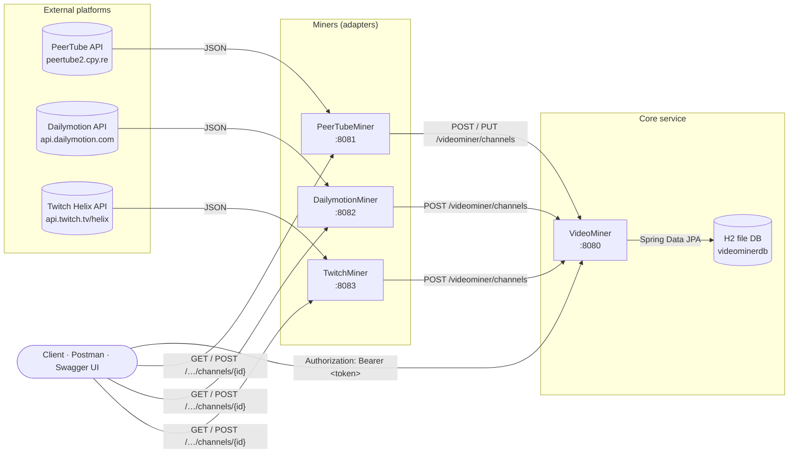
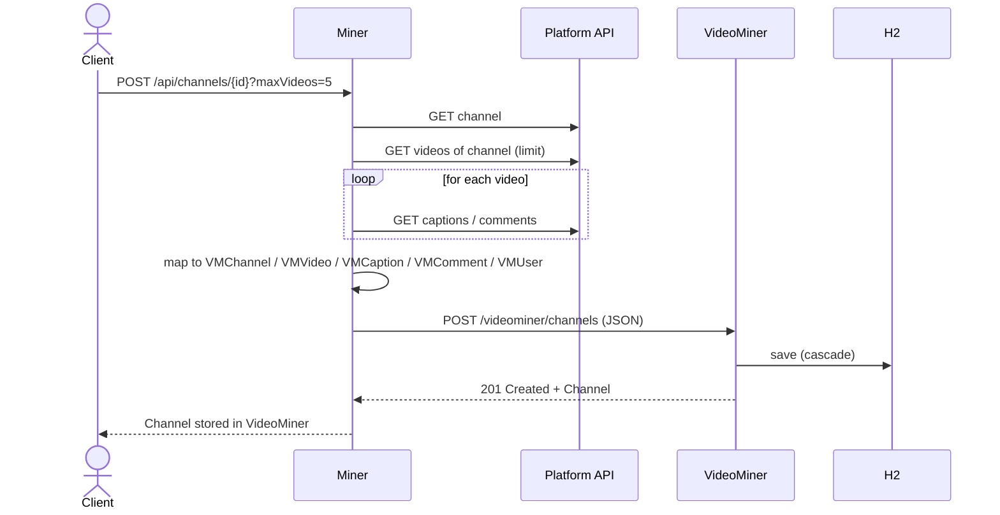
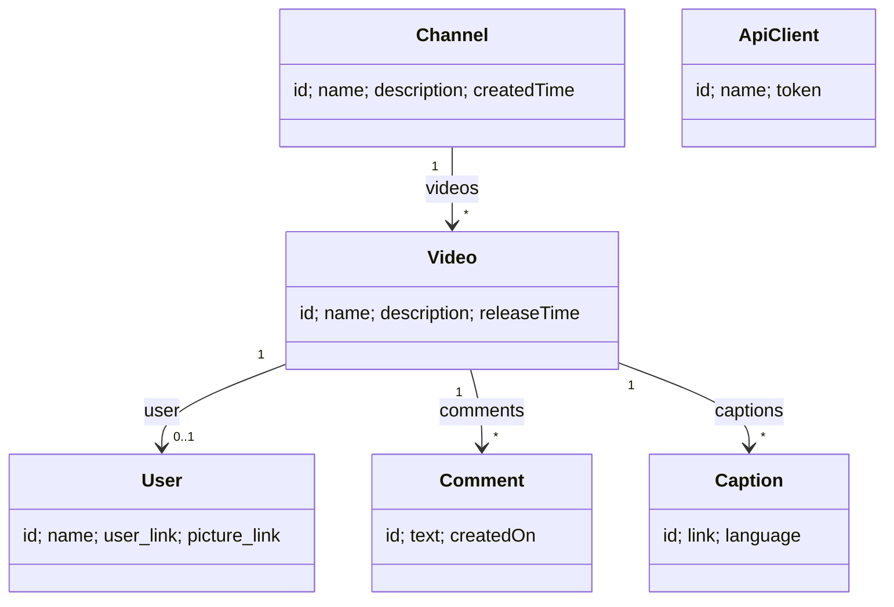

# VideoMiner — Video Data Mining Microservices

> 🇪🇸 [Leer en español](README.es.md)

[](https://openjdk.org/projects/jdk/21/)
[](https://spring.io/projects/spring-boot)
[](https://maven.apache.org/)
[](https://microservices.io/)
[](https://www.informatica.us.es/)

A set of **four Spring Boot microservices** that extract (*mine*) channel and video data from three public video platforms — **PeerTube**, **Dailymotion** and **Twitch** — translate it into one common data model, and store it in a central REST API called **VideoMiner**.

Built as the group project for **Arquitectura e Integración de Sistemas Software (AISS)** — Software Engineering degree, ETSII, Universidad de Sevilla.

---

## Table of contents

- [VideoMiner — Video Data Mining Microservices](#videominer--video-data-mining-microservices)
  - [Table of contents](#table-of-contents)
  - [What the system does](#what-the-system-does)
  - [Architecture](https://microservices.io/)
  - [Repository layout](#repository-layout)
  - [Tech stack](#tech-stack)
  - [Quick start](#quick-start)
    - [Prerequisites](#prerequisites)
    - [1. Clone](#1-clone)
    - [2. Start VideoMiner first (port 8080)](#2-start-videominer-first-port-8080)
    - [3. Start the miners (one terminal each)](#3-start-the-miners-one-terminal-each)
  - [End-to-end example](#end-to-end-example)
  - [VideoMiner API (core)](#videominer-api-core)
  - [Miner APIs (adapters)](#miner-apis-adapters)
  - [Common data model](#common-data-model)
  - [How each platform is mapped](#how-each-platform-is-mapped)
  - [Security](#security)
  - [Configuration](#configuration)
  - [Testing](#testing)
  - [Design notes](#design-notes)

---

## What the system does

Every video platform has its own API with its own vocabulary: PeerTube talks about *video-channels* and *comment-threads*, Dailymotion about *subtitles* and *owners*, Twitch about *broadcasters*, *streams* and *clips*. The goal of the project is to **integrate these heterogeneous sources** behind a single, uniform API.

1. A **miner** receives a request such as "mine channel `X`".
2. It calls the external platform API, collects the channel, its videos and their captions/comments.
3. It **maps** everything to the shared VideoMiner model (`Channel → Video → Caption / Comment / User`).
4. It **sends** the result to VideoMiner with `POST /videominer/channels`.
5. VideoMiner **persists** it (JPA + H2) and exposes it through a paginated, filterable, token-protected REST API.

## Architecture

The miners follow the **Adapter pattern**: each one translates a provider-specific API into the same contract, so VideoMiner never needs to know where the data came from.



**Ingestion sequence** (same for every miner):



## Repository layout

```
.
├── VideoMiner/          # Core REST API: persistence, queries, API-key security, Swagger
├── PeerTubeMiner/       # Adapter for PeerTube
├── DailymotionMiner/    # Adapter for Dailymotion
├── TwitchMiner/         # Adapter for Twitch (Helix)
├── README.md            # This file (English)
└── README.es.md         # Spanish version
```

Each folder is an **independent Maven project** with its own `pom.xml` and Maven Wrapper (`mvnw` / `mvnw.cmd`), so each service can be built, run and deployed separately.

| Service          | Port   | Base path         | Spring Boot | Main package                      |
| ---------------- | ------ | ----------------- | ----------- | --------------------------------- |
| VideoMiner       | `8080` | `/videominer`     | 3.2.1       | `aiss.videominer`                 |
| PeerTubeMiner    | `8081` | `/api/channels`   | 3.5.15      | `peertubeminer.peertube`          |
| DailymotionMiner | `8082` | `/api/channels`   | 3.5.15      | `com.example.dailymotionminer`    |
| TwitchMiner      | `8083` | `/helix/channels` | 4.0.6       | `com.aisstwitchminer.twitchminer` |

## Tech stack

- **Java 21** and **Spring Boot** (Spring Web, Spring Data JPA, Bean Validation)
- **H2** database in file mode for VideoMiner (`./videominerdb`)
- **springdoc-openapi** — Swagger UI / OpenAPI 3 documentation for VideoMiner
- **RestTemplate** for service-to-service and external HTTP calls
- **Maven** (wrapper included) and **JUnit 5** tests
- Patterns: microservices, Adapter, DTOs per service (`model/<platform>` vs `model/videominer`), custom `HandlerInterceptor` for API keys

## Quick start

### Prerequisites

- **JDK 21** (`java -version` must show 21 or later)
- No Maven install needed — every service ships with the Maven Wrapper
- Internet access (miners call public APIs)
- For Twitch only: a Twitch app **Client ID** and an **OAuth app token** ([Twitch docs](https://dev.twitch.tv/docs/authentication/))

### 1. Clone

```bash
git clone https://github.com/<your-user>/<this-repo>.git
cd <this-repo>
```

### 2. Start VideoMiner first (port 8080)

The miners need VideoMiner running to store their data.

```bash
cd VideoMiner
./mvnw spring-boot:run          # Windows: mvnw.cmd spring-boot:run
```

Check it is up: open <http://localhost:8080/swagger-ui.html>.

### 3. Start the miners (one terminal each)

```bash
cd PeerTubeMiner    && ./mvnw spring-boot:run   # http://localhost:8081
cd DailymotionMiner && ./mvnw spring-boot:run   # http://localhost:8082
```

TwitchMiner reads its credentials from environment variables:

```bash
# Linux / macOS
export TWITCH_CLIENT_ID=your_client_id
export TWITCH_OAUTH_TOKEN=your_app_token
cd TwitchMiner && ./mvnw spring-boot:run        # http://localhost:8083
```

```powershell
# Windows PowerShell
$env:TWITCH_CLIENT_ID="your_client_id"
$env:TWITCH_OAUTH_TOKEN="your_app_token"
cd TwitchMiner; .\mvnw.cmd spring-boot:run
```

> ⚠️ Never commit real Twitch credentials. They are read from the environment on purpose.

## End-to-end example

```bash
# 1) Preview what PeerTube would send (nothing is stored)
curl "http://localhost:8081/api/channels/<channel-handle>?maxVideos=3&maxComments=2"

# 2) Mine it and store it in VideoMiner
curl -X POST "http://localhost:8081/api/channels/<channel-handle>?maxVideos=3&maxComments=2"

# 3) Get an API token from VideoMiner
curl -X POST http://localhost:8080/videominer/register/my-client
# -> {"id":1,"name":"my-client","token":"3f1c...-...."}

# 4) Query the stored data with the token
TOKEN=3f1c...
curl -H "Authorization: Bearer $TOKEN" "http://localhost:8080/videominer/channels?page=0&size=5"
curl -H "Authorization: Bearer $TOKEN" "http://localhost:8080/videominer/videos?name=tutorial&order=-releaseTime"
```

Dailymotion works the same way on port `8082`. Its channels are categories (`news`, `music`, `sport`…), e.g. `POST localhost:8082/api/channels/news?maxVideos=3&maxPages=1`. Twitch uses the numeric broadcaster id: `POST localhost:8083/helix/channels/{broadcasterId}`.

## VideoMiner API (core)

Base URL: `http://localhost:8080` · Interactive docs: `/swagger-ui.html` · OpenAPI spec: `/v3/api-docs`

| Method         | Endpoint                             | Description                                                                                              | Auth   |
| -------------- | ------------------------------------ | -------------------------------------------------------------------------------------------------------- | ------ |
| `POST` / `GET` | `/videominer/register/{serviceName}` | Register an API client and return its token (returns the existing one if the name is already registered) | Public |
| `GET`          | `/videominer/channels`               | List channels                                                                                            | Bearer |
| `GET`          | `/videominer/channels/{id}`          | Get one channel                                                                                          | Bearer |
| `POST`         | `/videominer/channels`               | Create a channel (with nested videos, captions, comments, users) — used by the miners                    | Public |
| `PUT`          | `/videominer/channels/{id}`          | Update a channel                                                                                         | Bearer |
| `DELETE`       | `/videominer/channels/{id}`          | Delete a channel                                                                                         | Bearer |
| `GET`          | `/videominer/videos`                 | List videos                                                                                              | Bearer |
| `GET`          | `/videominer/videos/{id}`            | Get one video                                                                                            | Bearer |
| `GET`          | `/videominer/videos/user/{userId}`   | Videos uploaded by a given user                                                                          | Bearer |
| `DELETE`       | `/videominer/videos/{id}`            | Delete a video                                                                                           | Bearer |
| `GET`          | `/videominer/comments`               | List comments                                                                                            | Bearer |
| `GET`          | `/videominer/comments/{id}`          | Get one comment                                                                                          | Bearer |
| `GET`          | `/videominer/captions`               | List captions                                                                                            | Bearer |
| `GET`          | `/videominer/captions/{id}`          | Get one caption                                                                                          | Bearer |

**Query parameters for list endpoints**

| Parameter     | Default | Applies to       | Meaning                                                                |
| ------------- | ------- | ---------------- | ---------------------------------------------------------------------- |
| `page`        | `0`     | all              | Page number (0-based)                                                  |
| `size`        | `10`    | all              | Page size                                                              |
| `order`       | —       | all              | Field to sort by; prefix with `-` for descending (e.g. `-releaseTime`) |
| `name`        | —       | channels, videos | Contains-filter on name                                                |
| `description` | —       | channels, videos | Contains-filter on description                                         |
| `text`        | —       | comments         | Contains-filter on text                                                |
| `language`    | —       | captions         | Contains-filter on language                                            |

**Status codes:** `200` OK · `201` Created · `204` No Content (PUT/DELETE) · `400` validation error (`{"errors": [...]}`) · `401` missing/invalid token · `404` resource not found.

## Miner APIs (adapters)

All three miners expose the same two operations: **preview** (`GET`, returns the mapped channel without storing it) and **ingest** (`POST`, maps it and sends it to VideoMiner).

| Miner                    | Endpoint                                         | Query params (defaults)             | Extra                                                                                                                    |
| ------------------------ | ------------------------------------------------ | ----------------------------------- | ------------------------------------------------------------------------------------------------------------------------ |
| PeerTubeMiner `:8081`    | `GET` / `POST` `/api/channels/{handle}`          | `maxVideos` (10), `maxComments` (2) | `PUT /api/channels/{handle}` re-mines and updates the channel in VideoMiner (it obtains its own API token automatically) |
| DailymotionMiner `:8082` | `GET` / `POST` `/api/channels/{channel}`         | `maxVideos` (10), `maxPages` (2)    | `{channel}` is a Dailymotion channel/category such as `news`                                                             |
| TwitchMiner `:8083`      | `GET` / `POST` `/helix/channels/{broadcasterId}` | `maxVideos` (10), `maxComments` (2) | Needs `TWITCH_CLIENT_ID` and `TWITCH_OAUTH_TOKEN`                                                                        |

Negative limits return `400 Bad Request`.

## Common data model



- Ids are `String`, dates are ISO-8601 `String` (each platform uses a different format/type).
- Relations use `CascadeType.ALL`, so posting one `Channel` stores the whole tree.
- `name`, `createdTime` (channel) and `name`, `releaseTime` (video) are validated with `@NotEmpty`.
- `ApiClient` is internal to VideoMiner and stores the API tokens.

Example payload the miners send:

```json
{
  "id": "123",
  "name": "My channel",
  "description": "…",
  "createdTime": "2021-03-01T10:00:00Z",
  "videos": [{
    "id": "abc",
    "name": "Video title",
    "description": "…",
    "releaseTime": "2023-05-10T18:30:00Z",
    "user": { "id": "u1", "name": "Author", "user_link": "https://…", "picture_link": "https://…" },
    "captions": [{ "id": "c1", "link": "https://…/en.vtt", "language": "English" }],
    "comments": [{ "id": "k1", "text": "Great video!", "createdOn": "2023-05-11T09:00:00Z" }]
  }]
}
```

## How each platform is mapped

| VideoMiner | PeerTube                                   | Dailymotion                                    | Twitch                                                     |
| ---------- | ------------------------------------------ | ---------------------------------------------- | ---------------------------------------------------------- |
| `Channel`  | video-channel (`displayName`, `createdAt`) | channel (`name`, `created_time`)               | channel / broadcaster + user (`description`, `created_at`) |
| `Video`    | video (`name`, `publishedAt`)              | video (`title`, `created_time`)                | video / VOD (`title`, `description`, `published_at`)       |
| `User`     | account (+ first avatar)                   | owner (`screenname`, `avatar_720_url`)         | user (`display_name`, `profile_image_url`)                 |
| `Caption`  | caption (`fileUrl`, language label)        | subtitle (`url`, `language`)                   | channel game (`box_art_url`, game name)                    |
| `Comment`  | comment-thread (`text`, `createdAt`)       | video tag (Dailymotion has no public comments) | clip of that video (`url`, `created_at`)                   |

When a platform has no exact equivalent, the closest concept was chosen so that the shared model is always filled.

## Security

VideoMiner protects its endpoints with a simple **API-key** scheme implemented in `ApiKeyInterceptor`:

1. A client calls `POST /videominer/register/{name}` and receives a random UUID token.
2. Every protected request must include `Authorization: Bearer <token>`.
3. Unknown or missing tokens get `401` with `{"error":"Unauthorized", ...}`.

Public routes: `/videominer/register/**`, Swagger (`/swagger-ui/**`, `/v3/api-docs/**`), the H2 console (`/h2-ui`) and `POST /videominer/channels` (so that miners can ingest data without a token). PeerTubeMiner's `PUT` registers itself as `peertubeminer` and sends its own Bearer token.

## Configuration

Every service reads `src/main/resources/application.properties`; any value can be overridden with an environment variable or `--key=value`.

| Service          | Property                                           | Default                                                                   |
| ---------------- | -------------------------------------------------- | ------------------------------------------------------------------------- |
| VideoMiner       | `spring.datasource.url`                            | `jdbc:h2:file:./videominerdb`                                             |
| VideoMiner       | `spring.h2.console.path`                           | `/h2-ui` (JDBC URL `jdbc:h2:file:./videominerdb`, user `sa`, no password) |
| PeerTubeMiner    | `peertube.base-url`                                | `https://peertube2.cpy.re`                                                |
| PeerTubeMiner    | `peertubeminer.maxVideos` / `maxComments`          | `10` / `2`                                                                |
| DailymotionMiner | `dailymotion.base-url`                             | `https://api.dailymotion.com`                                             |
| DailymotionMiner | `dailymotion.maxVideos` / `maxPages`               | `10` / `2`                                                                |
| TwitchMiner      | `twitch.base-url`                                  | `https://api.twitch.tv/helix`                                             |
| TwitchMiner      | `TWITCH_CLIENT_ID`, `TWITCH_OAUTH_TOKEN`           | *(env vars, empty by default)*                                            |
| All miners       | `videominer.base-url` + `videominer.channels-path` | `http://localhost:8080` + `/videominer/channels`                          |

To point a miner at another PeerTube instance, for example:

```bash
./mvnw spring-boot:run -Dspring-boot.run.arguments="--peertube.base-url=https://framatube.org"
```

## Testing

```bash
cd <Service> && ./mvnw test
```

- All services: `contextLoads` smoke test.
- PeerTubeMiner and DailymotionMiner: `ChannelServiceTest` calls the real external API (requires internet).
- Manual / integration testing was done with Postman and Swagger UI.

## Design notes

- Dates are stored as ISO-8601 strings because each platform returns them in a different format.
- Mapping from each platform to the VideoMiner model is written by hand in each miner's `ChannelController` (no MapStruct).


The base data model (`Channel`, `Video`, `Comment`, `Caption`, `User`) comes from the course template provided by the AISS teaching staff.

This repository is published for educational and portfolio purposes.
